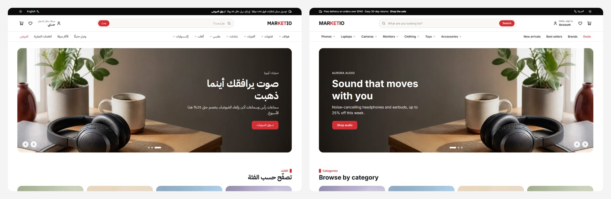
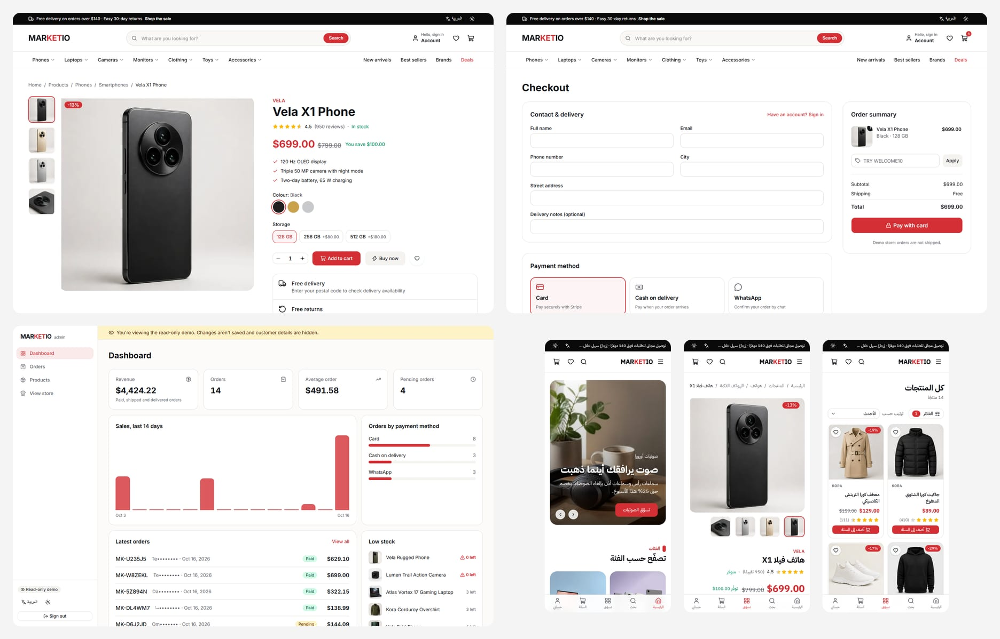

# Marketio

A bilingual online store (Arabic and English) with real checkout and an admin panel, built with Next.js 16 and Firebase. Arabic is the default and renders right-to-left; English is a full second locale, not a translation layer bolted on.

All products, brands, customers and orders are invented demo data. Card payments run in Stripe test mode.



## Problem → built → result

**Problem.** The original Marketio was a small React/Vite storefront with a hard-coded Stripe secret in a separate server, English only, no admin, and placeholder products. It couldn't be shown to clients selling to Arabic-speaking customers, where RTL layout, Arabic typography and local payment habits (cash on delivery, WhatsApp orders) matter as much as card checkout.

**Built.** A rebuild from scratch on the Next.js App Router:

- An Arabic-first storefront with 74 products across 7 categories, a rich home page, brand and category pages, search and filters.
- Three ways to pay: Stripe Checkout, cash on delivery, or an order sent over WhatsApp. Totals are always calculated on the server.
- Customer accounts with order history.
- An admin panel with a public, read-only demo login.

**Result.** Every page is server-rendered and indexable, with JSON-LD for products. The layout uses logical CSS only (`npm run check:rtl` fails on `left`/`right` classes), so both directions come from one codebase. Lighthouse scores 97–100 for accessibility and 100 for best practices on every storefront page.

## Features

**Storefront**
- `/ar` (default, RTL) and `/en` routes; IBM Plex Sans Arabic + Inter, Latin digits for prices in both languages.
- Home: hero slider, category tiles, flash sale with countdown, best sellers by category, brands, collections, testimonials, style gallery.
- Catalogue: URL-driven filters (category, sub-category, brand, price, rating, stock), sorting and pagination; brand, category and search pages.
- Product page: gallery, colour and size/storage options, specs, rating breakdown and reviews, related products, Open Graph image and Product JSON-LD.
- Cart and wishlist persisted in the browser; free shipping over $140; coupons `WELCOME10` and `MARKETIO15`.
- Journal, about, contact, FAQ and policy pages; sitemap and robots.

**Checkout and accounts**
- Stripe Checkout (test mode) with an exact discount coupon and shipping line; a signed webhook marks the order paid.
- Cash on delivery and WhatsApp orders (a prefilled message with the order summary).
- Orders stored in Firestore with IDs like `MK-4F7Q2C`; signed-in customers see their orders.
- Firebase Auth with email/password and Google.

**Admin** (`/ar/admin`, `/en/admin`)
- Sign-in for users with the `admin` custom claim (`npm run admin:grant -- you@example.com`), using a Firebase session cookie.
- **Try the admin demo**: no password, a signed two-hour cookie, read-only. Every server action refuses writes for this role and customer details are masked.
- Dashboard (revenue, 14-day sales, payment methods, latest orders, low stock, best sellers), orders with status changes, products with add/edit and photo upload to Vercel Blob.



## Stack

| Area | Choice |
| --- | --- |
| Framework | Next.js 16 (App Router, Cache Components, Partial Prerendering), React 19, TypeScript |
| UI | Tailwind CSS v4, shadcn/ui (Radix), lucide icons |
| i18n | next-intl (`/ar` + `/en`), RTL via logical properties |
| Data | Firestore through `firebase-admin` on the server only; Firebase Auth on the client |
| Payments | Stripe Checkout (test mode) + webhook |
| State | Zustand (cart, wishlist) with persisted storage |
| Uploads | Vercel Blob |
| Hosting | Vercel |

## Getting started

```bash
npm install
cp .env.example .env.local
npm run dev
```

Open http://localhost:3000. You'll be sent to `/ar` or `/en` based on your browser language.

The storefront runs with no keys at all: without Firebase credentials it reads the bundled demo catalogue, and card payment is hidden until a Stripe key is set. To use everything:

1. **Firebase:** create a project with Email/Password and Google sign-in and a Firestore database. Fill the `NEXT_PUBLIC_FIREBASE_*` web config, then a service account's `FIREBASE_PROJECT_ID`, `FIREBASE_CLIENT_EMAIL` and `FIREBASE_PRIVATE_KEY`. Run `npm run seed` to load the products and demo orders.
2. **Stripe:** a test-mode secret or restricted key (`sk_test_…` or `rk_test_…`) in `STRIPE_SECRET_KEY`. Live keys are refused on purpose. For the webhook, point an endpoint at `/api/stripe/webhook` for `checkout.session.completed` and put its signing secret in `STRIPE_WEBHOOK_SECRET`.
3. **Admin:** set `ADMIN_SESSION_SECRET` to a random string of 32+ characters, sign up once on `/account`, then run `npm run admin:grant -- you@example.com`.
4. **Uploads (optional):** a Vercel Blob read-write token in `BLOB_READ_WRITE_TOKEN`.
5. **WhatsApp (optional):** `NEXT_PUBLIC_WHATSAPP_NUMBER` in international format without `+`.

`firestore.rules` and `storage.rules` deny all direct browser access, because every read and write goes through the server. Deploy them with `firebase deploy --only firestore:rules,storage`.

## Scripts

| Script | What it does |
| --- | --- |
| `npm run dev` | Start the dev server |
| `npm run build` | Production build |
| `npm run lint` | ESLint |
| `npm run typecheck` | Generate route types, then `tsc --noEmit` |
| `npm run check:rtl` | Fail on physical `left`/`right` Tailwind classes (use `start`/`end`, `ms`/`me`, `ps`/`pe`) |
| `npm run seed` | Reset the Firestore `products` and `orders` collections to the demo data |
| `npm run admin:grant -- <email> [--revoke]` | Give or remove the `admin` claim |
| `npm run images:split`, `images:lifestyle` | Cut the AI-generated photo grids into product and banner images |

## Project layout

- `src/app/[locale]/(store)/` — storefront routes with the shop header and footer
- `src/app/[locale]/admin/` — admin login and the guarded `(panel)` routes
- `src/app/api/` — search suggestions and the Stripe webhook
- `src/lib/catalog.ts` — the one data-access module for products (Firestore, falling back to the bundled catalogue)
- `src/lib/orders.ts`, `src/lib/admin/` — orders, admin sessions and dashboard data (server only)
- `src/data/` — the demo catalogue (74 products, 8 invented brands) and page content
- `messages/{ar,en}.json` — every string, in both languages
